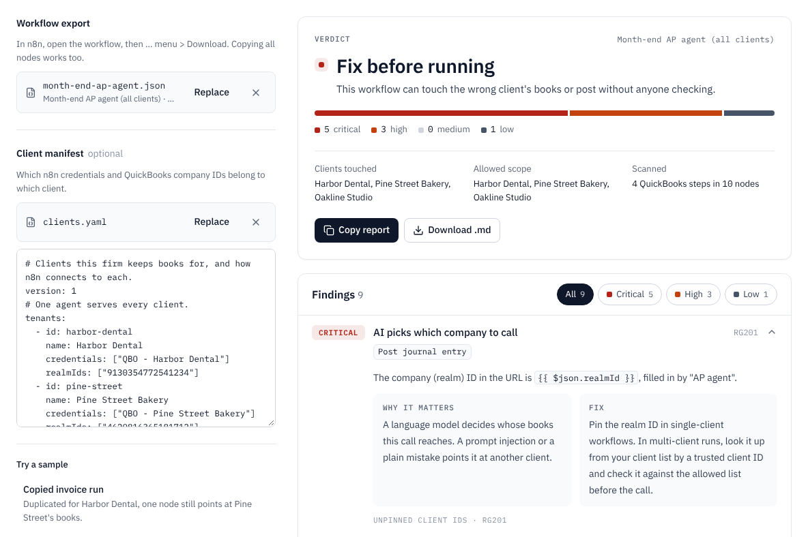
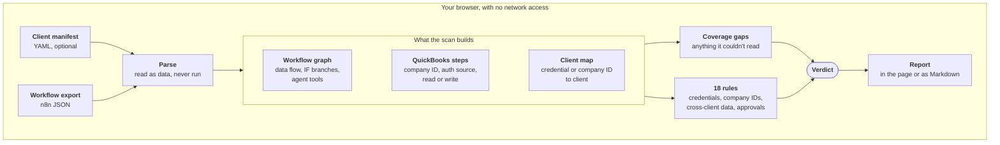

# Realm Guard

Checks that an n8n workflow stays inside each client's QuickBooks books before you switch it on.

One copied workflow that still uses the last client's credential is enough to post entries into the wrong client's books. So is one AI agent that can reach every company. I built Realm Guard to catch that from the workflow export, before anything runs.



## Quick start

```bash
npm ci
npm run build   # writes dist/index.html
```

Open `dist/index.html` in any browser, then drop in a workflow export or click a sample. The whole app is that one file. It works offline and uploads nothing.

## How it works



- **Parsing.** Both files are read as data. Expressions in the workflow are never run.
- **Graph.** The graph follows n8n's runtime, not the canvas:
  - Data passes through disabled nodes.
  - A `$('Node')` read counts as data flow.
  - Each IF and Switch output stays separate, so a write on the "no" branch doesn't count as approved.
- **QuickBooks steps.** Each step gets a company ID, an auth source and a read or write flag. A step is the QuickBooks node, its AI-tool version or an HTTP call to the QuickBooks API.
- **Client map.** The manifest ties each credential and company ID to a client. Without one, each credential or company ID stands in for a client.
- **Coverage gaps.** Anything it can't read becomes a gap, such as a missing credential or a sub-workflow. Any gap rules out a clean verdict.

The engine lives in `src/engine` and has no DOM code, so a CLI or CI check can wrap it later.

## What you give it

- **Workflow export.** In n8n, open the workflow and use **...** > **Download**, or copy every node on the canvas. Template-site downloads usually strip credentials, and the report says when they did.
- **Client manifest (optional).** It maps credentials and company IDs to clients. Click **Draft from this workflow** to get a starting one.

<details>
<summary>Example manifest</summary>

```yaml
version: 1
scope: [harbor-dental]                     # clients this workflow may touch
tenants:
  - id: harbor-dental
    name: Harbor Dental
    credentials: ["QBO - Harbor Dental"]   # n8n credential names or IDs
    realmIds: ["9130354772541234"]         # QuickBooks company IDs
  - id: pine-street
    name: Pine Street Bakery
    credentials: ["QBO - Pine Street Bakery"]
    realmIds: ["4620816365181712"]
approvalNodes: ["Airtable review queue"]   # your own review steps, if any
```

JSON works too. Company IDs keep every digit, quoted or not.

</details>

Without a manifest you still get the agent, approval and memory checks. The verdict can't be better than "Not verified", though.

## What it checks

| Rule | Flags | Severity |
| :-- | :-- | :-- |
| | **Shared credentials** | |
| RG101 | A credential that isn't mapped to any client | High |
| RG102 | Another client's credential (the copied-workflow mistake) | Critical |
| RG103 | A QuickBooks step with no credential in the export | Medium, and no clean verdict |
| RG104 | One credential serving several clients | High |
| RG105 | A token built from workflow data at run time | High, or medium if the token and company ID come from the same lookup item |
| RG106 | A bearer token pasted into the node | High |
| | **Unpinned client IDs** | |
| RG201 | A company ID taken from data | High, or critical if an AI picks it |
| RG202 | A company ID that belongs to a client outside the scope | Critical |
| RG203 | A company ID missing from the manifest | High |
| RG204 | A company ID and a credential that belong to different clients | High |
| | **Cross-client state** | |
| RG301 | One client's data written into another client's books | Critical |
| RG302 | One AI agent with tools for several clients | High, or critical if one writes |
| RG303 | AI memory with a fixed session key | High in multi-client workflows, otherwise medium |
| RG304 | Workflow static data in a multi-client workflow | High |
| | **Writes without approval** | |
| RG401 | A create, update, delete, send or void with no approval on the way | High, critical after an AI step, medium for manual runs |
| RG402 | An AI agent's write tool with no human review | Critical |
| RG403 | An approval whose answer nothing checks, or a write on the "no" branch | High |
| | **Export hygiene** | |
| RG501 | Pinned run data saved in the export | Low |

### What counts as an approval

These steps count as asking a person:

- Send and Wait in Slack, Gmail or Teams
- A Wait node that resumes on a form or webhook
- A human review step on an agent tool
- Any node you list under `approvalNodes`

n8n moves on after Send and Wait whatever the person clicks. The write has to sit on the "yes" output of an IF, Switch or Filter that reads the answer, such as `{{ $json.data.approved }}` is true. A check on anything else, like the amount, doesn't count.

### Verdicts

| Verdict | When |
| :-- | :-- |
| Fix before running | Any critical or high finding |
| Not verified | Part of the workflow couldn't be checked |
| Review before running | Only medium or low findings |
| No boundary issues found | Every QuickBooks step was checked and passed |

You can copy any report as Markdown.

## Limitations

- It reads the export only. It never runs the workflow or calls QuickBooks.
- Xero, Make and Zapier aren't covered yet.
- Sub-workflows are listed but not opened, so scan each one on its own.
- For a company ID or token that comes from an expression, it can say where the value comes from. It can't say whether the lookup is right.
- An approval check it can't read, like `!$json.data.approved`, counts as no check. RG403 can then fire on a check that's actually fine.
- Vector stores aren't checked for per-client namespaces yet.

I checked node types and defaults against the published n8n 2.48 packages. The engine has also run over 2,066 public workflow exports without a crash.

## Security

- Inputs are parsed as JSON and YAML, capped at 5 MB, and never run. Unknown manifest keys are rejected, so a typo can't widen the scope.
- Findings say where a token comes from and never print the expression itself.
- The page can't make network requests: its Content Security Policy sets `connect-src 'none'`. The end-to-end tests also fail if anything leaves the page.
- Nothing about your workflows is stored. Local storage holds only your theme choice. The clipboard is written only when you click Copy.
- `npm audit` reports no vulnerabilities. Dependencies are MIT, ISC and OFL-1.1 (the fonts, see `THIRD_PARTY_NOTICES.md`).

## Development

```bash
npm run check     # lint, typecheck, unit tests, build
npm run preview   # serves the build on :4173
python3 e2e/test_slice.py --base http://localhost:4173/ --dark   # Playwright journey
python3 e2e/test_slice.py --base dist/index.html --file --dark   # same, from file://
```

Design and technical choices are in `DECISIONS.md`, and what's next is in `ROADMAP.md`.

## License

MIT. The sample clients, credentials and company IDs are made up.
